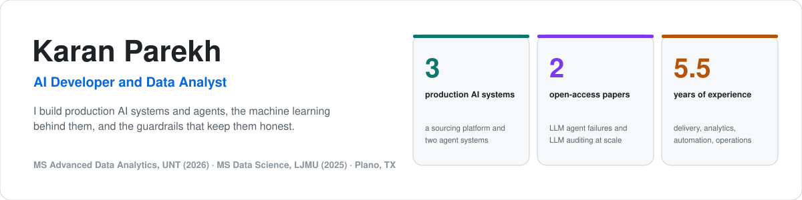

<picture>
  <source media="(prefers-color-scheme: dark)" srcset="assets/header-dark.svg">
  
</picture>

   

I build machine learning pipelines, production AI platforms and autonomous agent systems. About 5.5 years of industry experience across technical delivery, analytics, automation and operations, now building AI-powered products and applying ML to real business problems.

---

### Publications

| Year | Work | Where |
|------|------|-------|
| 2026 | **When the Agent Speaks for the Company: A Twelve-Week Experience Report on Failure Boundaries and Control Design in a Multi-Party LLM Agent** | [Zenodo, doi:10.5281/zenodo.22704694](https://doi.org/10.5281/zenodo.22704694) |
| 2026 | **When Auditors Fabricate: Batch-Size Degradation and Confident Hallucination in LLM Detection of Planted Document Contamination** | [Zenodo, doi:10.5281/zenodo.21939087](https://doi.org/10.5281/zenodo.21939087) · [arXiv:2609.09696](https://arxiv.org/abs/2609.09696) |

*When the Agent Speaks for the Company* is a single-author field study of a large language model agent that ran for twelve weeks inside a working business, speaking to staff, partner staff and outside counterparties. It codes 45 logged incidents by causal mechanism and impact, measures a confidentiality leak rate against the full message record, and quantifies how much the incident log itself undercounts. The coded incident record is released as a CSV supplement.

*When Auditors Fabricate* tests whether a frontier model can find deliberately planted errors in academic papers. It reports where that ability collapses, and shows that the failure mode at scale is confident fabrication rather than abstention.

Both are open access under CC BY 4.0. The links above are concept DOIs and always resolve to the newest version.

ORCID: [0009-0000-1681-3274](https://orcid.org/0009-0000-1681-3274) · Google Scholar: [Karan Parekh](https://scholar.google.com/citations?user=EXaI72QAAAAJ)

---

### What I Build

**Production AI systems**
- **[The Agency](https://github.com/karanparekh14/the-agency)**: three AI agents on WhatsApp and one Handler agent that commands them from my phone, with sender-verified commands against prompt injection, code-first mail triage, walled agents and a deploy gate that traces every change. Live since August 2026.
- **[SourceWithAI](https://sourcewithai.com)**: a full-stack AI-powered B2B sourcing platform with conversational search and multi-model AI search across supplier networks (Next.js, Express, FastAPI, MongoDB, Redis, Elasticsearch). I led its build and operation through May 2026; the platform remains live.
- **[Chotu](https://github.com/karanparekh14/chotu-ai-agent)**: an autonomous WhatsApp operations agent that ran business operations daily from February to May 2026: product sourcing, presentation generation, email campaigns and team coordination, with guard code against fabricated numbers.

**Machine learning and statistical research**
- Classification, regression, NLP, XGBoost, SHAP interpretability
- Hierarchical regression on 519,284 federal employee survey responses (2024 FEVS) that surfaced a Simpson's Paradox
- LLM evaluation research testing Gemini's contamination detection on 150 academic PDFs
- Field research on failure boundaries and control design in production LLM agents

---

### Tech Stack

| Area | Tools |
|---|---|
| **Languages** |      |
| **AI and ML** |           |
| **Search and data** |     |
| **Web and APIs** |       |
| **Infrastructure and delivery** |        |
| **Analytics and integrations** |      |

---

### Featured Projects

| Project | What it does | Stack |
|---------|-------------|-------|
| [**The Agency**](https://github.com/karanparekh14/the-agency) | Three WhatsApp AI agents run by one Handler agent. Sender-verified commands against prompt injection, code-first mail triage, walled agents and a deploy gate. **Live since August 2026.** | Python, OpenClaw, Claude, WSL2, GitHub Actions |
| [**SourceWithAI Platform**](https://github.com/karanparekh14/sourcewithai-platform) | AI-powered B2B sourcing marketplace: an eight-stage search pipeline over three supplier networks, 52 API route files and about 294 handlers. Led through May 2026; the platform remains live. | Next.js, Express, FastAPI, MongoDB, Elasticsearch, Redis, GPT-4o, Claude |
| [**Chotu: AI Operations Agent**](https://github.com/karanparekh14/chotu-ai-agent) | WhatsApp operations agent: product sourcing, decks, email campaigns, CRM checks, persistent memory. **Ran in production from February to May 2026.** | OpenClaw, Claude Haiku and Sonnet, Node.js, Gamma API, OTAPI, SmartLead |
| [**LLM Evaluation Research**](https://github.com/karanparekh14/llm-contamination-detection-eval) | Tested Gemini's ability to find 450 planted contaminants in 150 academic PDFs: recovery fell from 50 to 60 percent to **2.8 percent** at scale. Published: [When Auditors Fabricate](https://doi.org/10.5281/zenodo.21939087), also [arXiv:2609.09696](https://arxiv.org/abs/2609.09696). | Python, Gemini API, NLP |
| [**Customer Churn Prediction**](https://github.com/karanparekh14/CUSTOMER-CHURN-PREDICTION-IN-TELECOM-USING-MACHINE-LEARNING) | Interpretable XGBoost and SHAP classification for telecom churn. **78.2% accuracy, 0.848 AUC** on the held-out test set, with a modelled retention business case. | Python, XGBoost, SHAP, SMOTE |
| [**Federal Employee Satisfaction**](https://github.com/karanparekh14/federal-employee-satisfaction-analysis) | Hierarchical OLS regression on 519,284 FEVS 2024 survey records, final R² of .597. **Surfaced a Simpson's Paradox** in telework data. | Python, Statsmodels, XGBoost |
| [**Lead Scoring Model**](https://github.com/karanparekh14/Lead-Score-Case-Study) | Logistic regression lead scoring. **81.5% test accuracy, 76.3% recall.** ROC-AUC 0.88 on train, VIF multicollinearity analysis. | Python, Scikit-learn, Statsmodels |
| [**RAG Q&A on Vertex AI**](https://github.com/karanparekh14/genai-rag-qa-portfolio) | UNT course project I led: grounded, cited answers over 100 PDFs that refuse out-of-corpus questions. | Vertex AI, Gemini 2.5 Pro, LangChain (coursework) |

---

*Currently seeking Data Analyst / Data Scientist / ML Engineer roles.*
